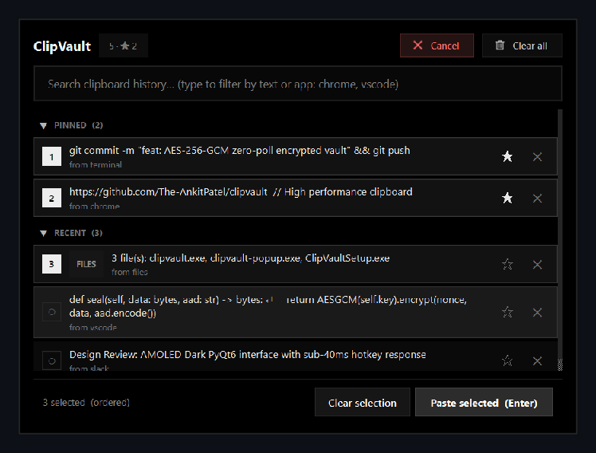

<p align="center">
  
</p>

<p align="center">
  <a href="https://github.com/The-AnkitPatel/clipvault/releases"></a>
  <a href="LICENSE"></a>
  
  
  
  
</p>

---

## Overview

**ClipVault** is a fast, tamper-proof, AMOLED-dark clipboard manager for Windows.

Press **`Win+V`** and your clipboard history opens in about **38 milliseconds**. Text, rich formatting, screenshots, images, and Explorer file copies are stored locally under authenticated **AES-256-GCM** encryption wrapped by **Windows DPAPI** or an **Argon2id** passphrase.

Windows' built-in clipboard history is slow to open (~500–800 ms), stores clips unencrypted in plain text SQLite databases, and forgets images on reboot. ClipVault fixes that with an event-driven daemon, a pre-warmed UI, and zero-compromise encryption.

---

## Visual Preview

<p align="center">
  
  <br/>
  <em><b>Figure 1:</b> AMOLED Dark UI featuring pinned items, syntax code clips, image thumbnails, and Explorer file copies.</em>
</p>

<p align="center">
  
  <br/>
  <em><b>Figure 2:</b> Continuous Glide Selection with numbered ordering (<code>[1]</code>, <code>[2]</code>, <code>[3]</code>) and atomic single-undo batch paste.</em>
</p>

---

## Why ClipVault is SOTA

ClipVault was built to replace Windows' built-in `Win+V` and outdated clipboard tools with modern cryptography and instant responsiveness:

| Feature / Metric | ClipVault | Windows Native (Win+V) | Ditto | CopyQ |
| :--- | :--- | :--- | :--- | :--- |
| **Popup Latency** | **~38 ms** (pre-warmed daemon) | ~350–800 ms (cold XAML launch) | ~150–300 ms (Win32 list) | ~200–500 ms (Qt widget launch) |
| **Encryption at Rest** | **AES-256-GCM + DPAPI / Argon2id** | None (Plaintext SQLite) | Optional weak cipher | Optional basic encryption |
| **Tamper Resistance** | **Authenticated AAD (path bound)** | None | None | None |
| **Password Manager Privacy** | **Strictly honored** (`ExcludeClipboard...`) | Inconsistent | Records secrets indiscriminately | Requires manual regex |
| **Format Fidelity** | **Text + HTML + RTF + Files + PNG** | Text + Images only | Raw formats | Plugin dependent |
| **Multi-Item Paste** | **Continuous Glide Selection** (ordered single-undo) | Click one by one | Ctrl+Click (clunky) | Scripted multi-paste |
| **Monitoring Overhead** | **0% CPU** (`WM_CLIPBOARDUPDATE` event) | OS integrated | Hook / periodic polling | Hook / polling |
| **Flameshot Integration** | **Native PrtScn takeover into history** | None | None | None |
| **Interface Design** | **Pure AMOLED Dark (#000000)** | Windows Fluent (heavy backdrop) | Legacy Win32 dialogs | Standard Qt theme |

---

## Key Features

* ⚡ **Sub-40ms Instant Response:** The UI window is constructed when the background daemon boots and kept warm. Pressing `Win+V` shows an existing handle instead of launching a new process (~820 ms cold start down to ~38 ms).
* 🔒 **Military-Grade Authenticated Encryption:** Every stored file (text, thumbnail, image, file path, index) is sealed with **AES-256-GCM** using fresh 96-bit random nonces. Each entry's storage path is bound as **Additional Authenticated Data (AAD)** to prevent file substitution or replay attacks.
* 🛡️ **Zero-Leak Password Manager Privacy:** Automatically honors Windows clipboard privacy flags (`ExcludeClipboardContentFromMonitorProcessing` and `CanIncludeInClipboardHistory`). Secrets copied from Bitwarden, 1Password, KeePass, browsers, or Remote Desktop are never written to disk.
* 🎯 **Continuous Glide-to-Select:** Click and drag downward across items to queue them in order (`[1]`, `[2]`, `[3]`). Drag back upward to remove items from the queue. Text clips are joined and pasted in a single keystroke so a single `Ctrl+Z` reverses the entire batch.
* 📋 **Full Format Fidelity:**
  * **Text & Code:** Retains full Unicode text with syntax spacing.
  * **Rich Text (HTML & RTF):** Preserves formatting copied from Microsoft Word, Google Docs, or web browsers without collapsing into flat text.
  * **Images & Screenshots:** Captures native PNG and DIB formats with lightweight, high-resolution 76x52 previews.
  * **Explorer Files (`CF_HDROP`):** Restores real binary file objects to the clipboard, allowing you to paste files directly into folders or applications.
* 📸 **Flameshot Screenshot Bridge:** Intercepts `PrtScn` to trigger Flameshot's screenshot overlay. Captured regions are automatically saved directly into the encrypted history.
* 🏷️ **Intelligent App Attribution:** Inspects the active foreground process (`win32process`) and assigns clean source badges (e.g., `from vscode`, `from chrome`, `from terminal`, `from files`).
* 📌 **Pinned Clips & Smart Cleanup:** Pinned items never expire and survive `Clear all`. Collapsible sections keep frequently used credentials or commands organized.
* 🖤 **Minimalist AMOLED Dark Aesthetic:** Crafted with pitch-black `#000000` styling, sharp borders, slim custom scrollbars, and vector SVG icons.

---

## Installation

Download **`ClipVaultSetup.exe`** from [**Releases**](https://github.com/The-AnkitPatel/clipvault/releases) and run it.

```cmd
ClipVaultSetup.exe
```

That is the entire setup. One self-contained installer:
1. Copies ClipVault into `%LOCALAPPDATA%\ClipVault`.
2. Frees `Win+V` by disabling Windows' built-in clipboard history.
3. Frees `PrtScn` from Snipping Tool conflicts.
4. Registers auto-start on user login (`HKCU\...\Run`).
5. Boots the daemon immediately.

### To Uninstall

```cmd
ClipVaultSetup.exe --uninstall
```

Reverses all registry modifications and removes the binary directory.

---

## Keyboard & Mouse Controls

| Shortcut / Action | Function |
| :--- | :--- |
| **`Win+V`** / **`Alt+V`** | Open or dismiss the ClipVault popup |
| **Type text** | Real-time fuzzy filter by text content or source app (`from chrome`) |
| **`Up` / `Down`** | Navigate through clipboard items |
| **`Enter`** | Paste highlighted clip, or paste the entire multi-selection queue |
| **`Tab`** | Toggle current item in/out of the multi-selection queue |
| **`Delete`** | Permanently delete the highlighted clip from the vault |
| **`Esc`** | Close popup |
| **`PrtScn`** | Trigger Flameshot screenshot overlay directly into history |
| **Click row** | Instantly paste item to target window |
| **Click `★` / `☆`** | Pin or unpin item (pinned items survive "Clear all") |
| **Click `✕`** | Delete individual clip |
| **Glide Drag** | Click and drag down across rows to select in order; drag up to deselect |

---

## Security Model

ClipVault operates on a zero-trust storage principle:

* **Default Wrap (DPAPI):** The 256-bit AES data encryption key is wrapped using Windows Data Protection API (`CryptProtectData`) tied to your Windows user logon credentials. The keyring file is ACL-hardened (`icacls /inheritance:r`) so other users on the system cannot read it.
* **Passphrase Wrap (Argon2id):** Optional user-defined passphrase derived via **Argon2id** (128 MiB memory cost, 4 passes, 4 lanes, random 16-byte salt). ClipVault prompts for password on startup and terminates if authentication fails.
* **Integrity Checked:** Tampering with any file in `%APPDATA%\ClipVault` causes decryption to fail and reject the file rather than returning garbage data.

For detailed threat modeling and boundary guarantees, see [SECURITY.md](SECURITY.md) and [`clipvault_crypto.py`](clipboard/clipvault_crypto.py).

---

## Architecture

ClipVault runs as a lightweight single-process daemon hosting a Qt event loop:
1. **Low-Level Keyboard Hook (`WH_KEYBOARD_LL`):** Catches `Win+V`, `Alt+V`, and `PrtScn` before Windows consumes them, injecting synthetic keystrokes to prevent Start Menu popups.
2. **Event-Driven Listener (`WM_CLIPBOARDUPDATE`):** Uses Win32 `AddClipboardFormatListener` to receive push notifications only when the clipboard changes (0% idle CPU).
3. **Pre-Warmed Window:** Keeps the popup ready in memory (~26–80 MB RAM), dropping launch latency to 38 ms.
4. **Binary Optimization:** Unused Qt6 modules (OpenGL, QtWebEngine, Network stack) are pruned from the release bundle, and UPX compression is omitted to eliminate AV false positives.

For full architectural diagrams and execution flow, see [ARCHITECTURE.md](ARCHITECTURE.md).

---

## Building from Source

### Prerequisites
* Windows 10 or 11 (64-bit)
* Python 3.12+

```cmd
git clone https://github.com/The-AnkitPatel/clipvault.git
cd clipvault

py -3.12 -m venv .venv
.venv\Scripts\pip install -r requirements.txt
```

### Running in Development

```cmd
.venv\Scripts\python clipboard\clipboard_daemon.pyw
```

### Compiling Binaries

```cmd
clipboard\build-exe.bat        rem Compiles bin\clipvault.exe and bin\clipvault-popup.exe
setup\build-installer.bat      rem Generates release\ClipVaultSetup.exe
```

### Running Tests

```cmd
.venv\Scripts\python tests\test_vault.py
.venv\Scripts\python tests\test_clipboard_formats.py
.venv\Scripts\python tests\test_sensitive_clips.py
```

---

## File System Locations

| Directory / Target | Path |
| :--- | :--- |
| **Binaries & Assets** | `%LOCALAPPDATA%\ClipVault\` |
| **Encrypted History & Keyring** | `%APPDATA%\ClipVault\` |
| **Auto-Start Registry** | `HKCU\Software\Microsoft\Windows\CurrentVersion\Run` |

*Note: Uninstalling preserves your encrypted clips in `%APPDATA%\ClipVault`. You can remove that folder manually if you wish to purge all history.*

---

## Contributing

Contributions, bug reports, and pull requests are welcome! Please read [CONTRIBUTING.md](CONTRIBUTING.md) and check [AGENTS.md](AGENTS.md) before submitting changes.

---

## License

Distributed under the **MIT License**. See [LICENSE](LICENSE) for details.

Copyright (c) 2026 Ankit Patel.
