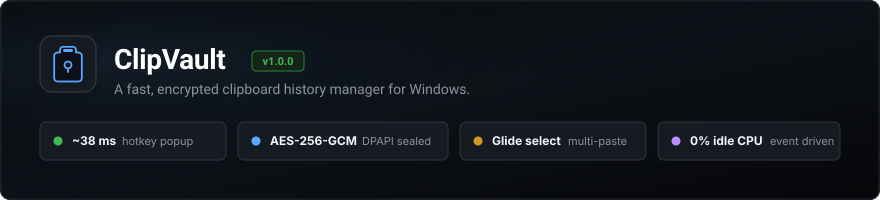

<p align="center">
  
</p>

<p align="center">
  <a href="https://github.com/The-AnkitPatel/clipvault/releases"></a>
  <a href="LICENSE"></a>
  
  
  
  
</p>

---

A clipboard that remembers, on Windows — and keeps what it remembers encrypted.

Press **`Win+V`** and your clipboard history opens in about **38 milliseconds**: text, formatted content, images, screenshots, and files copied in Explorer. Pin items to keep them forever, or pick multiple clips to paste them in order. Everything written to disk is encrypted with **AES-256-GCM**.

Built because Windows' built-in clipboard history is slow to open, stores clips in plain text, and forgets images when you reboot.

---

## Preview

<p align="center">
  
</p>

---

## How it compares

| Feature | ClipVault | Windows Clipboard (`Win+V`) | Ditto | CopyQ |
| :--- | :--- | :--- | :--- | :--- |
| **Popup speed** | **~38 ms** (pre-warmed window) | ~350–800 ms (cold XAML launch) | ~150–300 ms (Win32 list) | ~200–500 ms (Qt launch) |
| **Encryption at rest** | **AES-256-GCM + DPAPI / Argon2id** | None (plaintext SQLite) | Optional password | Optional encryption |
| **Tamper check** | **Path-bound AAD** | None | None | None |
| **Password managers** | **Honors privacy flags** | Inconsistent | Records everything | Manual regex rules |
| **Formats kept** | **Text + HTML + RTF + Files + PNG** | Text + Images only | Raw formats | Plugin dependent |
| **Multi-item paste** | **Glide drag & drop (single-undo)** | Click one by one | Ctrl+Click | Scripted |
| **Idle CPU usage** | **0%** (`WM_CLIPBOARDUPDATE` event) | Integrated in OS | Polling / hook | Polling / hook |
| **Flameshot support** | **`PrtScn` takeover straight to history** | None | None | None |
| **UI style** | **AMOLED dark (`#000000`)** | Fluent | Win32 classic | Qt desktop |

---

## What it does

* **Instant popup (~38 ms):** The window is built once when the daemon starts and kept in memory. Pressing `Win+V` simply unhides the window instead of launching a fresh process.
* **Encrypted at rest (AES-256-GCM):** Every clip, thumbnail, and index entry is encrypted using AES-256-GCM with a random 96-bit nonce. Each file's relative storage path is authenticated via Additional Authenticated Data (AAD) to prevent file swapping or replay.
* **Key protection (DPAPI or Passphrase):** The master key is wrapped via Windows DPAPI under your user account by default. You can also opt into a passphrase derived with Argon2id (128 MiB, 4 passes, 4 lanes).
* **Respects password manager privacy:** Listens for Windows clipboard flags (`ExcludeClipboardContentFromMonitorProcessing` and `CanIncludeInClipboardHistory`). Secrets copied from Bitwarden, 1Password, KeePass, or Remote Desktop are never recorded.
* **Glide to select (multi-paste):** Drag the mouse downward to queue multiple clips in order (`[1]`, `[2]`, `[3]`). Drag upward to remove them. Pasting concatenated text items counts as a single action, so one `Ctrl+Z` undoes the whole batch.
* **Full format fidelity:**
  * **Text:** Retains Unicode text and code indentation.
  * **Rich Text (HTML & RTF):** Preserves formatting copied from browsers, Word, or Google Docs.
  * **Images & Screenshots:** Captures PNG and DIB clipboard images with 76x52 preview thumbnails.
  * **Explorer Files (`CF_HDROP`):** Copies actual file references, not just path strings.
* **Flameshot integration:** Takes over `PrtScn` to launch Flameshot's overlay, and automatically saves captured screenshots straight into the encrypted history.
* **Source app badges:** Detects the foreground process and displays clean source tags (e.g. `from vscode`, `from chrome`, `from terminal`).
* **Pinned clips:** Pinned items stay forever and survive "Clear all". Sections can be collapsed.
* **Lightweight:** Stripped down PyQt6 bundle (no OpenGL, no WebEngine, no network libraries) without UPX packing to avoid false antivirus flags.

---

## Installation

Download **`ClipVaultSetup.exe`** from [**Releases**](https://github.com/The-AnkitPatel/clipvault/releases) and run it.

```cmd
ClipVaultSetup.exe
```

The installer:
1. Copies the program to `%LOCALAPPDATA%\ClipVault`.
2. Disables Windows' built-in clipboard history so `Win+V` belongs to ClipVault.
3. Frees `PrtScn` from Snipping Tool.
4. Adds startup entry in `HKCU\Software\Microsoft\Windows\CurrentVersion\Run`.
5. Launches the background daemon.

### Uninstall

```cmd
ClipVaultSetup.exe --uninstall
```

Reverses registry settings and deletes the program files.

---

## Shortcuts & Controls

| Shortcut / Action | What it does |
| :--- | :--- |
| **`Win+V`** / **`Alt+V`** | Open or close the vault |
| **Type** | Filter clips by text content or source app (`from chrome`) |
| **`Up` / `Down`** | Move through items |
| **`Enter`** | Paste highlighted clip, or paste the queued selection |
| **`Tab`** | Add or remove highlighted clip from multi-paste selection |
| **`Delete`** | Delete highlighted clip |
| **`Esc`** | Close window |
| **`PrtScn`** | Open Flameshot overlay directly into history |
| **Click row** | Paste item |
| **Click `★` / `☆`** | Pin or unpin item |
| **Click `✕`** | Delete item |
| **Drag mouse** | Drag down across rows to select in order; drag back up to deselect |

---

## Security

* **DPAPI (default):** Key is protected by Windows `CryptProtectData` tied to your login credentials. Key file permissions are locked to your user account (`icacls /inheritance:r`).
* **Argon2id (optional):** Key can be derived from a custom passphrase. Prompts on startup and aborts if incorrect.
* **Integrity:** GCM auth tags guarantee modified or corrupted files fail to open rather than returning broken text.

Read [SECURITY.md](SECURITY.md) and [`clipvault_crypto.py`](clipboard/clipvault_crypto.py) for the complete threat model and cryptographic details.

---

## Building from source

### Requirements
* Windows 10 or 11 (64-bit)
* Python 3.12+

```cmd
git clone https://github.com/The-AnkitPatel/clipvault.git
cd clipvault

py -3.12 -m venv .venv
.venv\Scripts\pip install -r requirements.txt
```

### Run in development

```cmd
.venv\Scripts\python clipboard\clipboard_daemon.pyw
```

### Build executables

```cmd
clipboard\build-exe.bat        rem Builds bin\clipvault.exe and bin\clipvault-popup.exe
setup\build-installer.bat      rem Builds release\ClipVaultSetup.exe
```

### Tests

```cmd
.venv\Scripts\python tests\test_clipboard_formats.py
.venv\Scripts\python tests\test_sensitive_clips.py
.venv\Scripts\python tests\test_vault.py
```

---

## Where things live

| Directory | What is there |
| :--- | :--- |
| **Binaries** | `%LOCALAPPDATA%\ClipVault\` |
| **Clips, index, key** | `%APPDATA%\ClipVault\` |
| **Startup entry** | `HKCU\Software\Microsoft\Windows\CurrentVersion\Run` |

*Note: Uninstalling leaves your clips in `%APPDATA%\ClipVault`. Delete the folder manually if you want all history removed.*

---

## Contributing

See [CONTRIBUTING.md](CONTRIBUTING.md).

---

## License

MIT — see [LICENSE](LICENSE).

Copyright (c) 2026 Ankit Patel.
