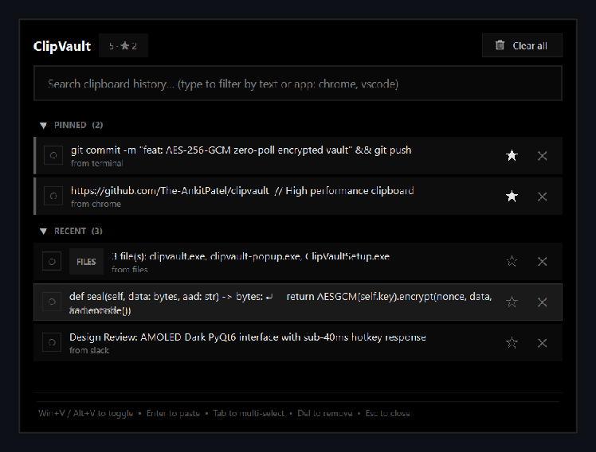

<p align="center">
  
</p>

<p align="center">
  <a href="https://github.com/The-AnkitPatel/clipvault/releases"></a>
  <a href="LICENSE"></a>
  
  
  
  
</p>

---

A clipboard that remembers, on Windows — and keeps what it remembers encrypted.

Press **`Win+V`** and your history is on screen in about **38 ms**: text, rich text, images, screenshots, and files copied in Explorer. Pin what you want to keep. Drag down the list to pick several and paste them in order. Everything written to disk is sealed with **AES-256-GCM** under a key that is never in this source tree.

Built because Windows' own clipboard history takes most of a second to open, keeps your clips in a plain-text database, and throws images away when you reboot.

---

## Preview

<p align="center">
  
</p>

---

## How it compares

| | ClipVault | Windows (`Win+V`) | Ditto | CopyQ |
| :--- | :--- | :--- | :--- | :--- |
| **Popup speed** | **~38 ms** (window kept warm) | ~350–800 ms (cold XAML) | ~150–300 ms | ~200–500 ms |
| **Encryption at rest** | **AES-256-GCM, DPAPI or Argon2id** | None (plaintext SQLite) | Optional password | Optional |
| **Tamper detection** | **GCM tag + path-bound AAD** | None | None | None |
| **Password managers** | **Honours the privacy flags** | Inconsistent | Records everything | Manual regex rules |
| **Formats kept** | **Text + HTML + RTF + files + PNG** | Text + images | Raw formats | Plugin dependent |
| **Multi-paste** | **Drag to pick, pastes in order** | One at a time | Ctrl+Click | Scripted |
| **Bulk delete** | **Pick a whole section, delete it** | All or nothing | Manual | Manual |
| **Idle CPU** | **0%** — `WM_CLIPBOARDUPDATE`, no polling | In the OS | Polling / hook | Polling / hook |
| **Screenshots** | **`PrtScn` → Flameshot → history** | None | None | None |

---

## What it does

* **Opens instantly.** The window is built once when the daemon starts and kept in memory. `Win+V` unhides it; it does not launch a process.
* **Sealed on disk.** Every clip, thumbnail and the index itself is AES-256-GCM with a fresh 96-bit nonce. The file's path inside the store goes in as additional authenticated data, so a sealed clip cannot be lifted out and passed off as a different one.
* **Your key, not ours.** A random 256-bit data key is generated on first run and stored wrapped — by Windows DPAPI under your account, or by Argon2id from a passphrase (128 MiB, 4 passes, 4 lanes). Nothing secret lives in this repository.
* **Leaves secrets alone.** Watches for `ExcludeClipboardContentFromMonitorProcessing` and `CanIncludeInClipboardHistory`. Clips from Bitwarden, 1Password, KeePass or an RDP session are never written down.
* **Keeps the formatting.** Unicode text with indentation intact, HTML and RTF so a paste into Word still looks like Word, PNG and DIB images with a 76×52 preview, and `CF_HDROP` file references rather than path strings.
* **Pick several, paste in order.** Drag down the list to queue clips `1`, `2`, `3`; drag back up to drop them. The batch pastes as one action, so a single `Ctrl+Z` undoes all of it.
* **Pick a section, delete it.** Each heading has a square that selects everything under it. Delete removes exactly what is picked — pinned clips included.
* **Screenshots go straight in.** `PrtScn` opens Flameshot's overlay and the capture lands in the encrypted history.
* **Tells you where a clip came from.** `from chrome`, `from vscode`, `from terminal`.
* **Stays small and quiet.** A stripped PyQt6 bundle: no OpenGL, no WebEngine, no network stack. Not UPX-packed, because that is what gets a new binary flagged by antivirus.

---

## How it works

```
  Win+V ──► RegisterHotKey ──┐                      ┌── ClipboardPopup (built once, hidden)
            (LL hook as a    ├──► clipvault.exe ────┤
             fallback)       │      the daemon      ├── tray icon
                             │                      └── Vault (data key held in memory)
  Ctrl+C ──► WM_CLIPBOARDUPDATE ──┘                            │
                                                               ▼
                                              %APPDATA%\ClipVault\  (every file sealed)
```

Three things make it quick:

**The window is never built on the hotkey.** The daemon constructs the popup at startup and hides it. `Win+V` positions and shows an object that already exists, with the index already decrypted in memory. That is the whole 38 ms — most of it is Windows bringing a window to the foreground.

**Nothing polls.** Capture hangs off `AddClipboardFormatListener`, so the process sits at 0% until the clipboard actually changes. No timer, no hook on the clipboard chain.

**The list paints in slices.** The first pass draws twelve rows — enough to fill the window — and the rest stream in on later event-loop passes. A hundred rows up front was most of the delay between the keypress and something on screen.

---

## On-disk format

Everything in `%APPDATA%\ClipVault\` is a sealed container:

```
┌────────┬─────────┬──────────────┬───────────────────────────┐
│ "CLVT" │ version │ nonce        │ ciphertext ‖ GCM tag      │
│ 4 B    │ 1 B (2) │ 12 B         │ n B ‖ 16 B                │
└────────┴─────────┴──────────────┴───────────────────────────┘
   AAD = b"clipvault/v2/" + the file's path inside the store
```

| File | What it holds |
| :--- | :--- |
| `index.json` | The clip list: id, kind, source app, preview, pinned flag |
| `<id>.txt` / `.png` / `.files` | The clip itself |
| `<id>.fmt` | HTML and RTF versions of a text clip |
| `thumbs/<id>.png` | 76×52 preview, so a reopen never decodes a full screenshot |
| `keyring.json` | The wrapped data key — the only secret, and it never leaves the machine |
| `popup-settings.json` | Which sections you folded away |

`keyring.json` is one of two shapes:

```jsonc
{ "wrap": "dpapi",    "key": "<DPAPI blob>", "version": 2 }

{ "wrap": "argon2id", "key": "<AES-GCM wrapped>", "nonce": "...",
  "kdf": { "name": "argon2id", "salt": "...",
           "time_cost": 4, "memory_kib": 131072, "parallelism": 4 } }
```

Containers from before 1.0 and files that were never encrypted are read transparently and rewritten in the current format. The store keeps the 200 most recent clips and draws the first 100.

---

## Security

**What it protects.** Your history on disk. A sealed clip opened with the wrong key, or edited by anything, fails its GCM tag and refuses to decrypt rather than handing back nonsense. The keyring has its inherited ACLs stripped (`icacls /inheritance:r`), so another account on the machine cannot read it, and neither can anyone who walks off with the drive.

**What it does not protect — read this part.**

* **The live clipboard is not ours to protect.** Any process on Windows can read what you just copied. That is how the OS clipboard works, and no clipboard manager changes it. ClipVault protects what it *stores*.
* **DPAPI is per-account, not per-app.** In the default mode, any program running as you can ask Windows to unwrap the data key — the same trust boundary as your browser's saved cookies. It stops another account and it stops offline access to the disk. It does not stop malware already running as you. A passphrase closes that gap, because the key is then derived from something that is not on disk.
* **Rollback is not detected.** The AAD binds a file's *name*, not a version. An older copy of the same file — a stale `index.json`, say — still opens cleanly. Deleting clip files is not detected either.
* **Passphrase mode has no switch yet.** `Vault.set_passphrase()` exists and is covered by tests, but nothing in the UI calls it. Tracked, not done.
* **Nobody has audited this.** One author, no third-party review. Read [`clipvault_crypto.py`](clipboard/clipvault_crypto.py) — it is 280 lines and the reasoning is in the comments.

[SECURITY.md](SECURITY.md) has the full threat model and how to report something.

---

## Installation

Download **`ClipVaultSetup.exe`** from [**Releases**](https://github.com/The-AnkitPatel/clipvault/releases) and run it.

```cmd
ClipVaultSetup.exe
```

It copies the program to `%LOCALAPPDATA%\ClipVault`, turns off Windows' own clipboard history so `Win+V` is free, frees `PrtScn` from the Snipping Tool, adds a startup entry under `HKCU\...\CurrentVersion\Run`, and starts the daemon.

```cmd
ClipVaultSetup.exe --check       rem unpack and verify the payload, install nothing
ClipVaultSetup.exe --uninstall   rem put the registry back, remove the program
```

Uninstalling leaves your clips in `%APPDATA%\ClipVault`. Delete that folder yourself if you want them gone.

---

## Shortcuts

| Key or action | What it does |
| :--- | :--- |
| **`Win+V`** / **`Alt+V`** | Open or close the vault |
| **Type** | Filter by clip text or source app |
| **`↑` `↓`** | Move through the list |
| **`Enter`** | Paste the highlighted clip, or the whole picked queue |
| **`Tab`** | Add or remove the highlighted clip from the queue |
| **`Delete`** | Delete the highlighted clip |
| **`Esc`** | Close |
| **`PrtScn`** | Flameshot overlay, straight into history |
| **Drag down the list** | Pick clips in order; drag back up to drop them |
| **Square in a heading** | Pick everything in that section, or drop it all |
| **`Delete N`** | Delete exactly what is picked, pinned clips included |
| **`★` / `☆`** | Pin or unpin |
| **`✕`** | Delete that clip |

---

## Building from source

Windows 10 or 11, 64-bit, and Python 3.12+.

```cmd
git clone https://github.com/The-AnkitPatel/clipvault.git
cd clipvault

py -3.12 -m venv .venv
.venv\Scripts\pip install -r requirements.txt
```

```cmd
rem run it straight from source
.venv\Scripts\python clipboard\clipboard_daemon.pyw

rem build
clipboard\build-exe.bat        rem bin\clipvault.exe and bin\clipvault-popup.exe
setup\build-installer.bat      rem release\ClipVaultSetup.exe

rem tests
.venv\Scripts\python tests\test_vault.py
.venv\Scripts\python tests\test_clipboard_formats.py
.venv\Scripts\python tests\test_sensitive_clips.py
```

| Path | What is in it |
| :--- | :--- |
| `clipboard/clipboard_daemon.pyw` | The daemon: hotkeys, clipboard listener, tray, autostart |
| `clipboard/clipboard_ui.py` | The window, every widget and the dialogs |
| `clipboard/clipboard_common.py` | Store layout, index, clipboard formats |
| `clipboard/clipvault_crypto.py` | The vault: containers, key wrapping, migration |
| `setup/installer.py` | The single-file installer |
| `tests/` | Vault round-trips, format fidelity, privacy flags |

| At runtime | Where |
| :--- | :--- |
| Program | `%LOCALAPPDATA%\ClipVault\` |
| Clips, index, key | `%APPDATA%\ClipVault\` |
| Startup entry | `HKCU\Software\Microsoft\Windows\CurrentVersion\Run` |

---

## A note on the numbers

~38 ms is the gap between the hotkey and the window being on screen, measured on the author's machine with the daemon warm — which is the only state it is ever in after login. It is not a benchmark suite, and a first launch after a reboot is slower while Windows pages the process in. The 0% idle figure is Task Manager with the clipboard untouched; the process genuinely has no timer.

---

## Contributing

[CONTRIBUTING.md](CONTRIBUTING.md). Issues and pull requests welcome — especially on the security notes above.

---

## License

MIT — see [LICENSE](LICENSE). Copyright (c) 2026 Ankit Patel.
